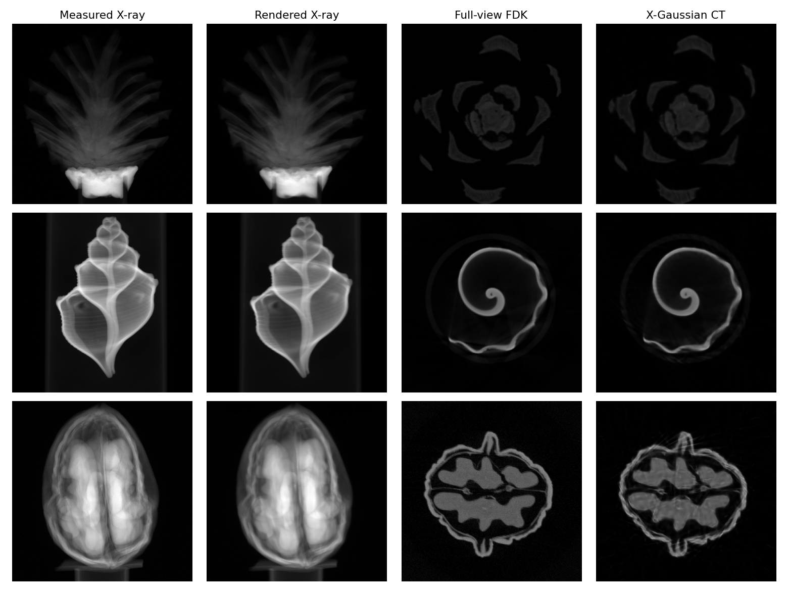

&nbsp;

<div align="center">

<p align="center">  </p>

[](https://arxiv.org/abs/2403.04116)
[](https://zhuanlan.zhihu.com/p/717744222)
[](https://www.youtube.com/watch?v=v6FESb3SkJg&t=28s)
[](https://x.com/_akhaliq/status/1765929288044290253?s=46)
[](https://x.com/janusch_patas/status/1766446189749150126?s=46)
[](https://huggingface.co/datasets/CaiYuanhao/X-Gaussian)
[](https://huggingface.co/CaiYuanhao/X-Gaussian)

<h2> Radiative Gaussian Splatting for Efficient X-ray Novel View Synthesis </h2> 


 

 

 

Point Cloud Visualization

&nbsp;

 

Training Process Visualization

</div>


&nbsp;


### Introduction
This is the official implementation of our ECCV 2024 paper "Radiative Gaussian Splatting for Efficient X-ray Novel View Synthesis". Our X-Gaussian is SfM-free. If you find this repo useful, please give it a star ⭐ and consider citing our paper. Thank you.


### News
- **2026.11.12 :** We updated the direct CT reconstruction code, scene configurations and pretrained models, reaching **33.25 dB** on synthetic scenes and **39.53 dB** on real scans.
- **2026.11.09 :** We added real-data reconstruction on Pine, Seashell, and Walnut, with [data](https://huggingface.co/datasets/CaiYuanhao/X-Gaussian/tree/main/real) and [pretrained models](https://huggingface.co/CaiYuanhao/X-Gaussian) available on Hugging Face.
- **2026.11.09 :** We released the [datasets](https://huggingface.co/datasets/CaiYuanhao/X-Gaussian) and [pretrained models](https://huggingface.co/CaiYuanhao/X-Gaussian) on Hugging Face. 🤗
- **2026.11.08 :** We added direct 3D reconstruction.
- **2025.06.25 :** Our new work [X2-Gaussian](https://arxiv.org/abs/2503.21779) for dynamic human chest breathing CT reconstruction has been accepted by ICCV 2025. Congrats to [Weihao](https://yuyouxixi.github.io/). Code and models will be released at [this repo](https://github.com/yuyouxixi/x2-gaussian).  🚀
- **2024.09.01 :** Code, models, and training logs have been released. Welcome to have a try 😆
- **2024.07.01 :** Our X-Gaussian has been accepted by ECCV 2024! Code will be released before the start date of the conference (2024.09.29). Stay tuned. 🚀
- **2024.06.03 :** Code for traditional methods has been released at [SAX-NeRF](https://github.com/caiyuanhao1998/SAX-NeRF). ✨
- **2024.06.03 :** Code for fancy visualization and data generation has been released at [SAX-NeRF](https://github.com/caiyuanhao1998/SAX-NeRF). 🚀
- **2024.06.03 :** Data, code, models, and training logs of our CVPR 2024 work [SAX-NeRF](https://github.com/caiyuanhao1998/SAX-NeRF) have been released. Feel free to use them :)
- **2024.06.03 :** The datasets have been released on [Google Drive](https://drive.google.com/drive/folders/1tBGulq6l-Gp_SI1UyylJgr9Zw01Oie3R?usp=sharing). Feel free to use them. 🚀
- **2024.03.07 :** Our paper is on [arxiv](https://arxiv.org/abs/2403.04116) now. Code, models, and training logs will be released. Stay tuned. 💫

### Performance

<details close>
<summary><b>Novel View Synthesis</b></summary>

Results from [Table 1 of the original paper](https://arxiv.org/html/2403.04116#S3.T1), not measurements of the CT checkpoints below.

| Scene | 2D PSNR (dB) | 2D SSIM |
|:--|--:|--:|
| Chest | 43.887 | 0.9998 |
| Abdomen | 45.762 | 0.9999 |
| Foot | 42.153 | 0.9997 |
| Head | 41.579 | 0.9997 |
| Pancreas | 43.640 | 0.9976 |
| **Average** | **43.404** | **0.9993** |


</details>

<details close>
<summary><b>Direct 3D CT Reconstruction</b></summary>

The CT extension uses the original Gaussian point attributes and native data resolution, with 50 training projections per scene. Synthetic recipes use 30,000 base steps and 15,000 refinement steps; real recipes use 30,000 joint projection/3D-TV steps. Settings were selected on held-out training projections. Reference volumes and test projections are used only for evaluation.

3D PSNR uses a fixed range of 1 without clipping or intensity correction. SSIM averages nonempty reference slices along each axis, then across axes. Synthetic references are the original CT volumes; real references are **full-view FDK pseudo-volumes**, not measured CT ground truth.

| Scene | CT resolution | 3D PSNR (dB) | 3D SSIM |
|:--|:--|--:|--:|
| Chest | 128 × 128 × 128 | 36.00 | 0.9391 |
| Abdomen | 512 × 512 × 463 | 34.27 | 0.8946 |
| Foot | 256 × 256 × 256 | 32.18 | 0.8815 |
| Head | 256 × 256 × 128 | 41.44 | 0.9768 |
| Pancreas | 512 × 512 × 240 | 22.38 | 0.8791 |
| **Average** | | **33.25** | **0.9142** |

</details>

<details close>
<summary><b>Real Data 3D CT Reconstruction</b></summary>

Real scans contain 50 training and 100 test projections at 560 × 560. The 3D reference is full-view FDK.

| Scene | CT resolution | 3D PSNR (dB) | 3D SSIM |
|:--|:--|--:|--:|
| Pine | 256 × 256 × 256 | 41.80 | 0.9465 |
| Seashell | 256 × 256 × 256 | 44.01 | 0.9638 |
| Walnut | 256 × 256 × 256 | 32.77 | 0.7169 |
| **Average** | | **39.53** | **0.8757** |



</details>

<details close>
<summary><b>Assistant CT Reconstruction</b></summary>


</details>

### Coordinate System

The coordinate system in circular cone-beam X-ray scanning follows the OpenCV standards. The transformation between the camera, world, and image coordinate systems is shown below.
<div align="center">
<p align="center">  </p>
</div>

&nbsp;

## 1. Environment

Use Linux with a CUDA 11.8 toolkit (`nvcc`). The environment installs Python 3.9,
PyTorch 2.1.2 and GCC 11 for both 2D projection rendering and 3D CT reconstruction.

```shell
git clone https://github.com/caiyuanhao1998/X-Gaussian.git
cd X-Gaussian
conda env create -f environment.yml
conda activate x_gaussian
export CUDA_HOME=/usr/local/cuda-11.8
export PATH="$CUDA_HOME/bin:$PATH"
bash install.sh
```

## 2. Dataset

Download the original five CT datasets and three real scans from [Hugging Face](https://huggingface.co/datasets/CaiYuanhao/X-Gaussian).
These datasets are also available on [Google Drive](https://drive.google.com/drive/folders/1tBGulq6l-Gp_SI1UyylJgr9Zw01Oie3R?usp=sharing).
With [Git LFS](https://git-lfs.com/) installed, run from the project root:

```shell
git lfs install
git clone https://huggingface.co/datasets/CaiYuanhao/X-Gaussian data
```

The processed data files are placed in `data/`:

```text
|--data
      |--synthetic
            # The first five datasets are used in our paper
            |--chest_50.pickle
            |--abdomen_50.pickle
            |--foot_50.pickle
            |--head_50.pickle
            |--pancreas_50.pickle
      |--real
            |--pine
            |--seashell
            |--walnut
```

Training reads these files directly and initializes from training projections.
Datasets and outputs can be stored elsewhere and symlinked into `data/` and `output/`.

Each real scene contains `meta_data.json`, 50 training and 100 test projections at
560 × 560, a 256³ full-view FDK pseudo-reference, and training-only initialization.
We preserve the released processed resolution without further downsampling.
See the [real-data sources and format](https://huggingface.co/datasets/CaiYuanhao/X-Gaussian/blob/main/real/README.md).

## 3. Testing

### Prepare Pretrained Models
Please download the pretrained models from [Hugging Face](https://huggingface.co/CaiYuanhao/X-Gaussian) using Git LFS:

```shell
git lfs install
git clone https://huggingface.co/CaiYuanhao/X-Gaussian pretrained
```

Our models can also be downloaded from [Google Drive](https://drive.google.com/drive/folders/1TmpuxMgKufvn_ltq0Z16smQfyKZrhR2F?usp=sharing). Please organize the models in `pretrained/` as
```text
|--pretrained/
      |--synthetic
            # The first five datasets are used in our paper
            |--chest
            |--abdomen
            |--foot
            |--head
            |--pancreas
      |--real
            |--pine
            |--seashell
            |--walnut
```

### 2D Projection Rendering

The downloaded checkpoints use the CT extension. Their measured projection metrics
are separate from the original paper NVS results reported above.

```shell
# synthetic scenes
python render.py -m pretrained/synthetic/chest --mode 2d
python render.py -m pretrained/synthetic/abdomen --mode 2d
python render.py -m pretrained/synthetic/foot --mode 2d
python render.py -m pretrained/synthetic/head --mode 2d
python render.py -m pretrained/synthetic/pancreas --mode 2d

# real scenes
python render.py -m pretrained/real/pine --mode 2d
python render.py -m pretrained/real/seashell --mode 2d
python render.py -m pretrained/real/walnut --mode 2d
```

Renders test cameras to each model folder’s `projections_test/` (raw NPY and PNG previews).

For physical integration of the same CT field, use:

```shell
python render.py -m pretrained/synthetic/chest --mode 2d --projection_renderer volume
```

The CUDA ray integrator is installed with the same environment. Add `--ray_backend torch`
to use the reference implementation. Physical integration and Gaussian rasterization
are different projection operators; both use the same trained field.

### 3D Reconstruction Testing

```shell
# synthetic scenes
python render.py -m pretrained/synthetic/chest --mode 3d
python render.py -m pretrained/synthetic/abdomen --mode 3d
python render.py -m pretrained/synthetic/foot --mode 3d
python render.py -m pretrained/synthetic/head --mode 3d
python render.py -m pretrained/synthetic/pancreas --mode 3d

# real scenes
python render.py -m pretrained/real/pine --mode 3d
python render.py -m pretrained/real/seashell --mode 3d
python render.py -m pretrained/real/walnut --mode 3d
```

Saves `volume.npy` in each model folder. Use `--output` to select another path.

The same trained Gaussians directly define the CT volume:

$$
V(\mathbf x)=\sum_i\rho_i\exp\!\left[-\frac12
(\mathbf x-\mathbf p_i)^\top\Sigma_i^{-1}(\mathbf x-\mathbf p_i)\right].
$$

Here $\rho_i=\sigma(o_i)\bar r_i$ combines the original opacity and positive radiative
intensity, and $\Sigma_i=R(q_i)D_iR(q_i)^\top$
uses the original rotations and squared scales in the diagonal matrix $D_i$. Reconstruction samples this field at
voxel centers; no extra learned density or voxel parameters are introduced.

3D mode also accepts a standalone CT-trained PLY via `-m path/to/point_cloud.ply`,
without projections or CT truth. The saved scanner resolution and extent are used by default; `--resolution`,
`--center` and `--size` override them. Both modes load the latest
checkpoint by default (`--iteration` selects another checkpoint).

## 4. Training

```shell
# synthetic scenes
python train.py --config config/synthetic/chest.yaml
python train.py --config config/synthetic/abdomen.yaml
python train.py --config config/synthetic/foot.yaml
python train.py --config config/synthetic/head.yaml
python train.py --config config/synthetic/pancreas.yaml

# real scenes
python train.py --config config/real/pine.yaml
python train.py --config config/real/seashell.yaml
python train.py --config config/real/walnut.yaml
```

Checkpoints are saved to `output/synthetic/<scene>/` or `output/real/<scene>/`.
Training reuses cached initialization when available; otherwise it computes and
saves FDK initialization automatically from the training projections.

Training jointly optimizes one Gaussian field for 2D projection rendering and direct 3D
reconstruction. The default YAML files contain the complete scene recipes: synthetic
scenes use 30,000 base steps plus three refinement stages (5,000 + 2,000 + 8,000);
real scenes use 30,000 joint projection/3D-TV steps. Each refinement stage resets Adam
and the random seed. No reference CT or test projection is used for training.

Real-data physical ray integration includes a 32-voxel margin at native spacing;
CT exports retain the original size. The original Gaussian point attributes are retained.

## 5. Evaluation

After rendering projections and exporting the volume, evaluate a checkpoint with:

```shell
python evaluate.py -m pretrained/synthetic/chest
```

Use `--mode 3d` to evaluate only `volume.npy`, or `--projection_renderer volume` after
rendering with that operator. Evaluation reads reference data and writes
`evaluation_raster.json` or `evaluation_volume.json`; training does not read the
reference CT. Measured CT-extension projection scores are not the original paper
NVS experiment. The 3D protocol is described under Performance.

## Citation
```sh
# X-Gaussian
@inproceedings{x_gaussian,
  title={Radiative gaussian splatting for efficient x-ray novel view synthesis},
  author={Yuanhao Cai and Yixun Liang and Jiahao Wang and Angtian Wang and Yulun Zhang and Xiaokang Yang and Zongwei Zhou and Alan Yuille},
  booktitle={ECCV},
  year={2024}
}

# sax-nerf
@inproceedings{sax_nerf,
  title={Structure-Aware Sparse-View X-ray 3D Reconstruction},
  author={Yuanhao Cai and Jiahao Wang and Alan Yuille and Zongwei Zhou and Angtian Wang},
  booktitle={CVPR},
  year={2024}
}

# X2-Gaussian
@inproceedings{x2_gaussian,
  title={X2-Gaussian: 4D Radiative Gaussian Splatting for Continuous-time Tomographic Reconstruction},
  author={Yu, Weihao and Cai, Yuanhao and Zha, Ruyi and Fan, Zhiwen and Li, Chenxin and Yuan, Yixuan},
  booktitle={ICCV},
  year={2025}
}
```

&nbsp;


## Acknowledgement

Our code and data are heavily borrowed from [SAX-NeRF](https://github.com/caiyuanhao1998/SAX-NeRF/) and [3DGS](https://github.com/graphdeco-inria/gaussian-splatting).
