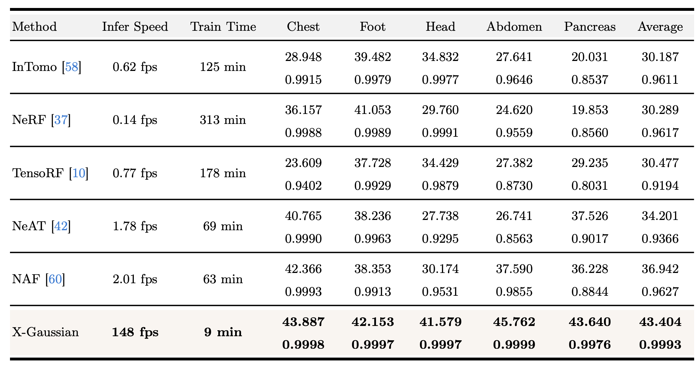
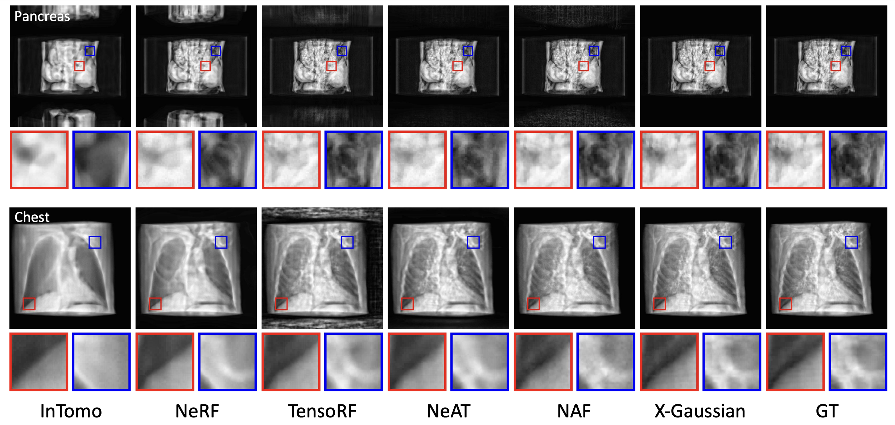
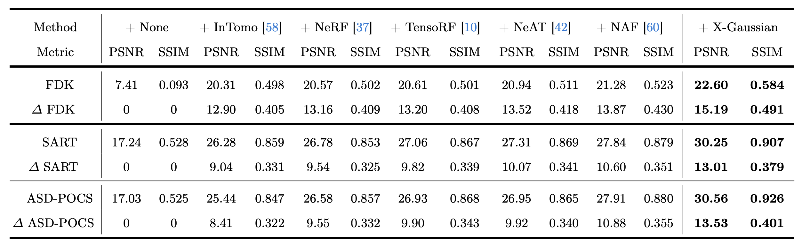
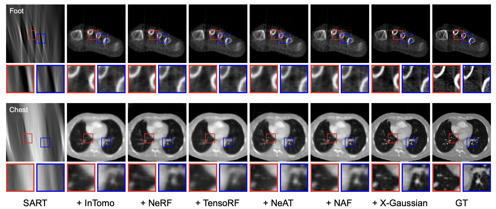
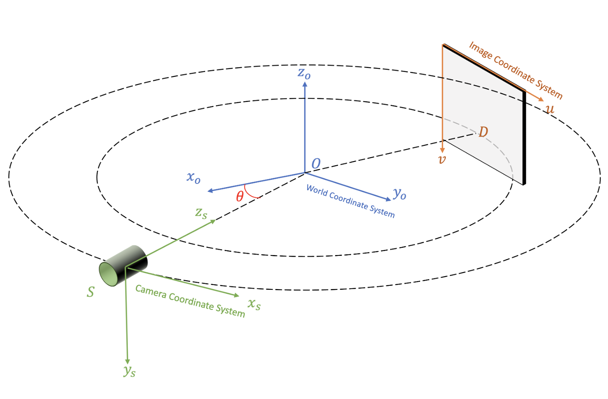
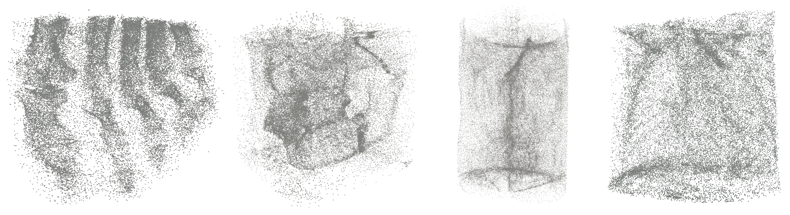
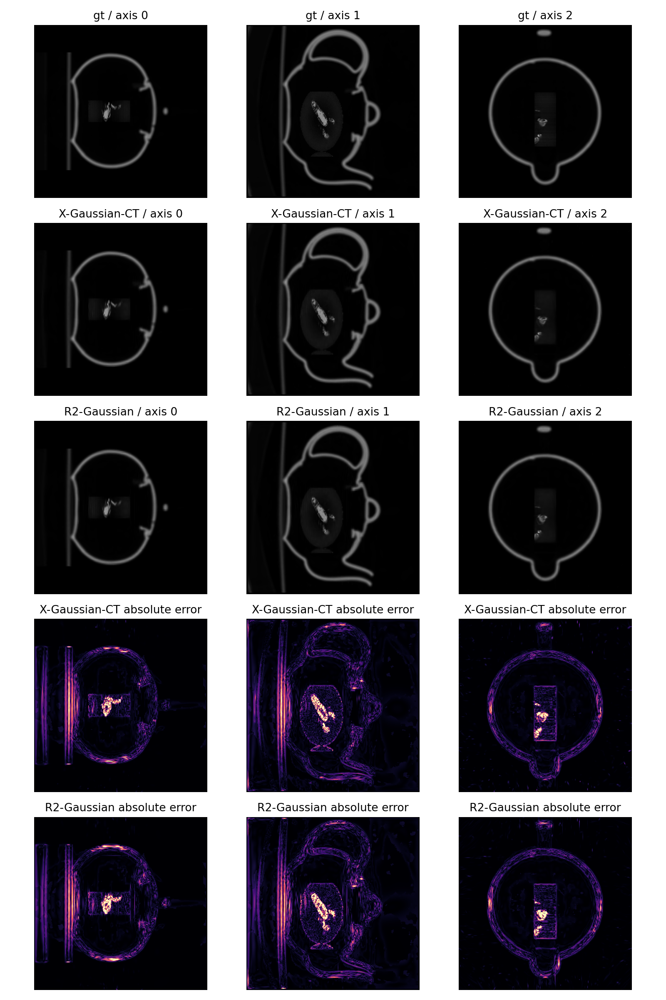
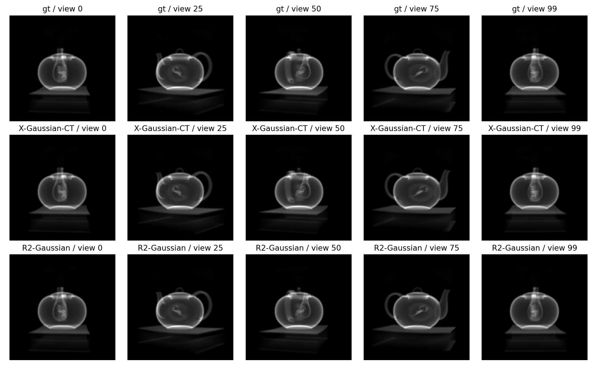

&nbsp;

<div align="center">

<p align="center">  </p>

[](https://arxiv.org/abs/2403.04116)
[](https://zhuanlan.zhihu.com/p/717744222)
[](https://www.youtube.com/watch?v=v6FESb3SkJg&t=28s)
[](https://x.com/_akhaliq/status/1765929288044290253?s=46)
[](https://x.com/janusch_patas/status/1766446189749150126?s=46)
[](https://radiancefields.com/x-gaussian-radiance-meets-radiation)

<h2> Radiative Gaussian Splatting for Efficient X-ray Novel View Synthesis </h2> 


 

 

 

Point Cloud Visualization

&nbsp;

 

Training Process Visualization

</div>


&nbsp;


### Introduction
This is the official implementation of our ECCV 2024 paper "Radiative Gaussian Splatting for Efficient X-ray Novel View Synthesis". Our X-Gaussian is SfM-free. If you find this repo useful, please give it a star ⭐ and consider citing our paper. Thank you.


### News
- **2026.11.08 :** Added [direct 3D CT reconstruction and testing](#3d-reconstruction-testing) using the original X-Gaussian point attributes. The recommended teapot recipe reaches **47.48 dB 3D PSNR**; training, PLY-only volume export, reconstruction equations, and the 2D/3D tradeoff are documented below.
- **2025.06.25 :** Our new work [X2-Gaussian](https://arxiv.org/abs/2503.21779) for dynamic human chest breathing CT reconstruction has been accepted by ICCV 2025. Congrats to [Weihao](https://yuyouxixi.github.io/). Code and models will be released at [this repo](https://github.com/yuyouxixi/x2-gaussian).  🚀
- **2024.09.25 :** Our new work [R2-Gaussian](https://arxiv.org/abs/2405.20693v1) has been accepted by NeurIPS 2024. Congrats to [Ruyi](https://ruyi-zha.github.io/). Code and model are  released at [this repo](https://github.com/Ruyi-Zha/r2_gaussian). 💫 
- **2024.09.01 :** Code, models, and training logs have been released. Welcome to have a try 😆
- **2024.07.01 :** Our X-Gaussian has been accepted by ECCV 2024! Code will be released before the start date of the conference (2024.09.29). Stay tuned. 🚀
- **2024.06.03 :** Code for traditional methods has been released at [SAX-NeRF](https://github.com/caiyuanhao1998/SAX-NeRF). ✨
- **2024.06.03 :** Code for fancy visualization and data generation has been released at [SAX-NeRF](https://github.com/caiyuanhao1998/SAX-NeRF). 🚀
- **2024.06.03 :** Data, code, models, and training logs of our CVPR 2024 work [SAX-NeRF](https://github.com/caiyuanhao1998/SAX-NeRF) have been released. Feel free to use them :)
- **2024.06.03 :** The datasets have been released on [Google Drive](https://drive.google.com/drive/folders/1SlneuSGkhk0nvwPjxxnpBCO59XhjGGJX?usp=sharing). Feel free to use them. 🚀
- **2024.03.07 :** Our paper is on [arxiv](https://arxiv.org/abs/2403.04116) now. Code, models, and training logs will be released. Stay tuned. 💫

### Performance

<details close>
<summary><b>Novel View Synthesis</b></summary>





</details>


<details close>
<summary><b>CT Reconstruction</b></summary>





</details>

### Coordinate System

The coordinate system in circular cone-beam X-ray scanning follows the OpenCV standards. The transformation between the camera, world, and image coordinate systems is shown below.
<div align="center">
<p align="center">  </p>
</div>

&nbsp;

## 1. Create Environment:

We recommend using [Conda](https://docs.conda.io/en/latest/miniconda.html) to set up the environment.

``` sh
# cloning our repo
git clone https://github.com/caiyuanhao1998/X-Gaussian --recursive


SET DISTUTILS_USE_SDK=1 # Windows only

# install the official environment of 3DGS
cd X-Gaussian
conda env create --file environment.yml
conda activate x_gaussian

# Use our X-ray rasterizer package to replace the original RGB rasterizer
rm -rf submodules/diff-gaussian-rasterization/cuda_rasterizer
mv cuda_rasterizer submodules/diff-gaussian-rasterization/

# re-install the diff-gaussian-rasterization package
pip install submodules/diff-gaussian-rasterization
```

&nbsp;


### Optional environment for 3D CT reconstruction

The CT extension uses a separate environment; the original 2D workflow above is unchanged.
The tested configuration is Linux, Python 3.9, PyTorch 2.1.2, and CUDA 11.8.
Install a matching CUDA toolkit with `nvcc` and a compatible C++ compiler (for example,
GCC 11), then run:

```shell
conda env create -f environment_ct.yml
conda activate x_gaussian_ct
# Initialize simple-knn if the repository was cloned without --recursive.
git submodule update --init --recursive submodules/simple-knn
bash install_ct.sh
```

`install_ct.sh` builds `simple-knn` and the separately named CT CUDA backend against
the activated PyTorch. It respects `CUDA_HOME`, `CC`, `CXX`, and `MAX_JOBS`.
See [CT_RECONSTRUCTION.md](CT_RECONSTRUCTION.md) for dependencies and attribution.

## 2. Prepare Dataset
Download our processed datasets from [Google drive](https://drive.google.com/drive/folders/1W46wpeN7byWLC0f3cGIvoT_xbwT1b7gZ?usp=sharing) or [Baidu disk](https://pan.baidu.com/s/1WrYhxFb8Y-RwS4PCx_LRhA?pwd=cyh2). Then put the downloaded datasets into the folder `data/` as

```sh
  |--data
      # The first five datasets are used in our paper
      |--chest_50.pickle
      |--abdomen_50.pickle
      |--foot_50.pickle
      |--head_50.pickle
      |--pancreas_50.pickle
      # The rest datasets are from the X3D benchmark
      |--aneurism_50.pickle
      |--backpack_50.pickle
      |--bonsai_50.pickle
      |--box_50.pickle
      |--carp_50.pickle
      |--engine_50.pickle
      |--leg_50.pickle
      |--pelvis_50.pickle
      |--teapot_50.pickle
      |--jaw_50.pickle
```

`Note:` The first five datasets are used to do experiments in our paper. The rest datasets are from [the X3D benchmark](https://github.com/caiyuanhao1998/SAX-NeRF/). Please also note that the pickle data used by X-Gaussian is dumped/read by pickle protocol 4, which is supported by python < 3.8. The original X3D data is processed by pickle protocol 5, which is supported by python >= 3.8. I have re-dumped the pickle data from the original X3D datasets to make sure you can run our code without extra effort. If you want to re-dump the pickle data, please run

```shell
python pickle_redump.py
```


&nbsp;

## 3. Training and Testing

### X-ray Projection Training and Testing

You can download our trained Gaussian point clouds from [Google Drive](https://drive.google.com/drive/folders/1-JqRXiwl1zjVKuBRL3F01cWHcyAe8f2F?usp=sharing) or [Baidu Disk](https://pan.baidu.com/s/1GWE5By6u03n2l6nnFhOE0g?pwd=cyh2) (code: `cyh2`) as



We share the training log for your convienience to debug. Please download them from [Google Drive](https://drive.google.com/drive/folders/1HKcy-luYLXTSH7vviu_djVtpbSdz_v6J?usp=sharing) or [Baidu Disk](https://pan.baidu.com/s/1amk0tnpH3hN9I-Qgjb_cEQ?pwd=cyh2) (code: `cyh2`). To make the training and evaluation easier, your can directly run the `train.sh` file by

```shell
bash train.sh
```

Or you can separately train on each scene like

```shell

python3 train.py --config config/chest.yaml --eval

python3 train.py --config config/foot.yaml --eval

python3 train.py --config config/abdomen.yaml --eval

python3 train.py --config config/head.yaml --eval

python3 train.py --config config/pancreas.yaml --eval

python3 train.py --config config/jaw.yaml --eval

python3 train.py --config config/pelvis.yaml --eval

python3 train.py --config config/aneurism.yaml --eval

python3 train.py --config config/carp.yaml --eval

python3 train.py --config config/bonsai.yaml --eval

python3 train.py --config config/box.yaml --eval

python3 train.py --config config/backpack.yaml --eval

python3 train.py --config config/engine.yaml --eval

python3 train.py --config config/leg.yaml --eval

python3 train.py --config config/teapot.yaml --eval

```

&nbsp;


### 3D Reconstruction Testing

This optional path directly queries a CT attenuation volume from a **CT-trained**
X-Gaussian PLY. It retains the original positions, 48 radiative coefficients,
opacity, log scales, and quaternion: **59 learned scalars and the original 62 PLY
columns per Gaussian**. No extra learned density, network, or voxel grid is added.
The original paper's alpha-composited checkpoints must be retrained with this CT
forward model before quantitative volume reconstruction.

**Prepare and train the recommended model.** Use the original-resolution cone-beam
NeRF-format data and 50,000-point FDK initialization from
[R2-Gaussian](https://github.com/Ruyi-Zha/r2_gaussian). For teapot, place or symlink
the `2_teapot_cone` directory under
`data_full/r2_synthetic_50/cone_ntrain_50_angle_360/`; it must contain
`meta_data.json`, its referenced projection/volume files, and
`init_2_teapot_cone.npy`. Keep datasets and outputs on your storage volume and
symlink `data_full/` and `output_ct/` into this checkout if needed.

```shell
conda activate x_gaussian_ct
GPU_ID=0 bash run_ct_precision.sh
# For another dataset location / output directory:
# DATA_PATH=/path/to/2_teapot_cone BASE_PATH=/path/to/base \
# OUTPUT_PATH=/path/to/recommended GPU_ID=0 bash run_ct_precision.sh
```

The fixed recipe in [config/ct_teapot.yaml](config/ct_teapot.yaml) uses 30,000 native
projection-training steps, followed by 1,000 physical-ray refinement steps with
8,192 sampled rays per step and ray weight 2. Images remain 512 x 512 and the queried
CT remains 256 cubed; auxiliary ray minibatches do not resize either. TV regularizes
attenuation and covariance, while its gradients to Gaussian centers are disabled;
projection and physical-ray losses still optimize the centers. The script finishes
by evaluating and verifying the exported PLY. R2 is not required to run this recipe.

**Reconstruction equations.** For Gaussian $i$, let $\mathbf p_i$, $\mathbf a_i$,
$q_i$, $o_i$, and $\mathbf f_{ik}\in\mathbb R^3$ denote its original position, log
scales, quaternion, raw opacity, and radiative coefficients. The recommended model is

$$
\begin{aligned}
\mathbf s_i &= \exp(\mathbf a_i), &
\Sigma_i &= R(q_i)\,\operatorname{diag}(\mathbf s_i^2)\,R(q_i)^\top,\\
\ell_{ic} &= \tfrac12+\sum_{k=0}^{15}w_k f_{ikc}, &
\rho_i &= \sigma(o_i)\,\frac{1}{3}\sum_{c=1}^{3}
\operatorname{softplus}_{\beta}(\ell_{ic}),\qquad \beta=1,\\
\mu_\theta(\mathbf x) &= \sum_{i=1}^{N}\rho_i
\exp\!\left[-\tfrac12(\mathbf x-\mathbf p_i)^\top
\Sigma_i^{-1}(\mathbf x-\mathbf p_i)\right].
\end{aligned}
$$

Here $R(q_i)$ uses the normalized quaternion, $\sigma$ is the sigmoid, and
$\operatorname{softplus}_{\beta}(z)=\log(1+e^{\beta z})/\beta$.
The $w_k$ are the **constant, view-independent weights from the original X CUDA
radiative decoder**, reproduced in [xct/field.py](xct/field.py); they are not
view-dependent RGB SH evaluation. $\rho_i$ is the peak attenuation, so the Gaussians
above have no probability-density normalization factor.

For volume center $\mathbf c$, physical extent $\mathbf L$, resolution $\mathbf n$,
and zero-based voxel index $\mathbf j$, reconstruction samples the field at voxel centers:

$$
\mathbf x_{\mathbf j}=\mathbf c-\frac{\mathbf L}{2}
+\left(\mathbf j+\tfrac12\mathbf 1\right)\odot\frac{\mathbf L}{\mathbf n},
\qquad V[\mathbf j]\simeq\mu_\theta(\mathbf x_{\mathbf j}).
$$

The CUDA implementation uses finite Gaussian support/tile culling and a small
contribution cutoff. The projection target is the line integral
$P_\theta(u)=\int\mu_\theta(\mathbf o+t\mathbf d_u)\,dt$ for a unit ray direction.
Native rendering uses a local perspective approximation; refinement additionally
uses the voxel-ray operator

$$
P_{\mathrm{vox}}(u)=\sum_{\mathbf j}L_{u\mathbf j}V[\mathbf j],
$$

where $L_{u\mathbf j}$ is the ray's intersection length
in voxel $\mathbf j$ (Siddon integration). No CT ground truth is used in these losses.

**Test a trained checkpoint without projections or CT ground truth:**

```shell
python export_ct.py \
  --model output_ct/teapot_ct_recommended/point_cloud/iteration_1000/point_cloud.ply \
  --output output_ct/teapot_ct_recommended/ct_volume.npy \
  --resolution 256 256 256 --size 2 2 2 --center 0 0 0
```

The PLY's global comments retain the field activation; its per-point columns are
unchanged. A standalone copied PLY is sufficient. Export writes an **xyz-ordered NPY**
volume and JSON geometry in the normalized scanner coordinate system. The default
extent is `[-1,1]^3`; use `--size` and `--center` for another query box. FDK is used
only for training initialization, not for inference.

**Evaluate projections and CT against the dataset referenced by the saved config**
(add `--source_path /path/to/2_teapot_cone` if the dataset has moved):

```shell
python evaluate_ct_model.py --model_path output_ct/teapot_ct_recommended --iteration 1000
python verify_ct_export.py --model_path output_ct/teapot_ct_recommended \
  --iteration 1000 --checks output_ct/teapot_ct_recommended/export_checks.json
```

The final `iteration_1000` is the refinement checkpoint after 30,000 base steps,
not a 1,000-step model trained from scratch. Evaluation writes `results.json`,
`eval/iter_001000/metrics.json`, `vol_pred.npy`, and `projections.npz`.
Verification copies only the PLY to an isolated directory, checks the original
62-column schema and finite losses, and requires its exported volume to match the
saved evaluation volume exactly.

**Measured teapot results** (seed 0, 50 train / 100 test views, no downsampling):

| Model | Total steps | 2D PSNR | Raw-intensity 2D PSNR | 3D PSNR | 3D SSIM |
|---|---:|---:|---:|---:|---:|
| X CT, before this update | 31,000 | 54.2289 | 64.4766 | 46.3974 | 0.990914 |
| **X CT, recommended** | **31,000** | **53.7233** | **64.0590** | **47.4791** | **0.990997** |
| Existing R2 baseline | 30,000 | 54.0160 | 64.2410 | 47.2091 | 0.990321 |

PSNR is in dB. The recommendation improves 3D PSNR by **1.0817 dB** over the previous
X CT checkpoint and **0.2700 dB** over this R2 baseline, with a **0.2927 dB** decrease
in native 2D PSNR versus R2. R2's official 2D metric normalizes each prediction and
reference by their own maxima; raw-intensity PSNR is included separately. 3D uses
range 1 without fitted gain, registration, clipping, or GT calibration.

This is an **adaptive, single-case engineering experiment**, not a claim of general
superiority. Final CT diagnostics informed the chosen source profile. X also uses
1,000 extra steps with full-volume queries and ray integration, so compute budgets
are not equal. See [results/ct_teapot.json](results/ct_teapot.json) and
[CT_RECONSTRUCTION.md](CT_RECONSTRUCTION.md) for the full protocol and checks.

<details>
<summary><b>3D CT slices and absolute errors: GT / recommended X / R2</b></summary>



</details>

<details>
<summary><b>2D X-ray projection comparison</b></summary>



</details>

&nbsp;

## 4. Visualization

We also provide code for the visualization of rotating the Gaussian point clouds

```shell

python point_cloud_vis.py

```

&nbsp;

## 5. Citation
```sh
# X-Gaussian
@inproceedings{x_gaussian,
  title={Radiative gaussian splatting for efficient x-ray novel view synthesis},
  author={Yuanhao Cai and Yixun Liang and Jiahao Wang and Angtian Wang and Yulun Zhang and Xiaokang Yang and Zongwei Zhou and Alan Yuille},
  booktitle={ECCV},
  year={2024}
}

# sax-nerf
@inproceedings{sax_nerf,
  title={Structure-Aware Sparse-View X-ray 3D Reconstruction},
  author={Yuanhao Cai and Jiahao Wang and Alan Yuille and Zongwei Zhou and Angtian Wang},
  booktitle={CVPR},
  year={2024}
}

# R2-Gaussian
@inproceedings{r2_gaussian,
  title={R2-Gaussian: Rectifying Radiative Gaussian Splatting for Tomographic Reconstruction},
  author={Ruyi Zha and Tao Jun Lin and Yuanhao Cai and Jiwen Cao and Yanhao Zhang and Hongdong Li},
  booktitle={NeurIPS},
  year={2024}
}

# X2-Gaussian
@inproceedings{x2_gaussian,
  title={X2-Gaussian: 4D Radiative Gaussian Splatting for Continuous-time Tomographic Reconstruction},
  author={Yu, Weihao and Cai, Yuanhao and Zha, Ruyi and Fan, Zhiwen and Li, Chenxin and Yuan, Yixuan},
  booktitle={ICCV},
  year={2025}
}
```

&nbsp;


## Acknowledgement

Our code and data are heavily borrowed from [SAX-NeRF](https://github.com/caiyuanhao1998/SAX-NeRF/) and [3DGS](https://github.com/graphdeco-inria/gaussian-splatting). The optional CT backend and metric helpers are adapted from [R2-Gaussian](https://github.com/Ruyi-Zha/r2_gaussian); see [UPSTREAM.md](submodules/x-gaussian-ct-rasterization/UPSTREAM.md) and the preserved licenses.
